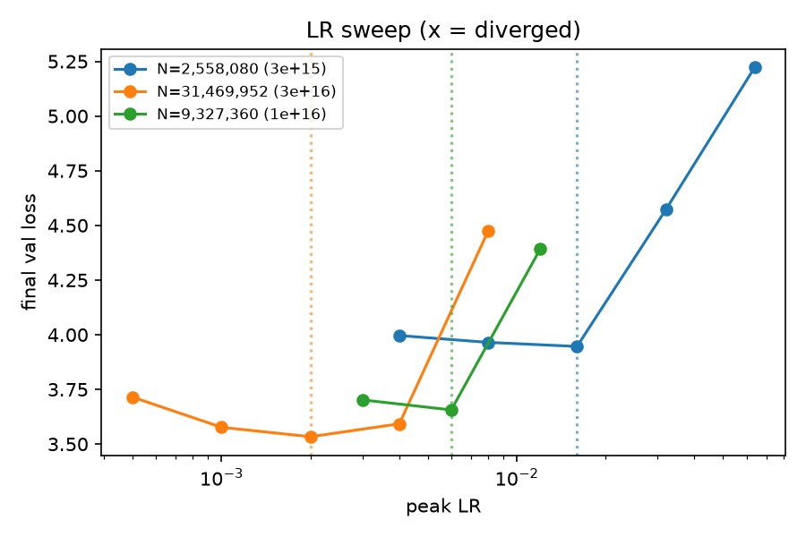
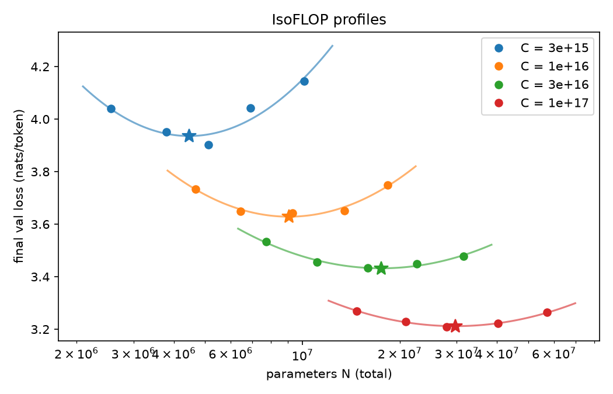
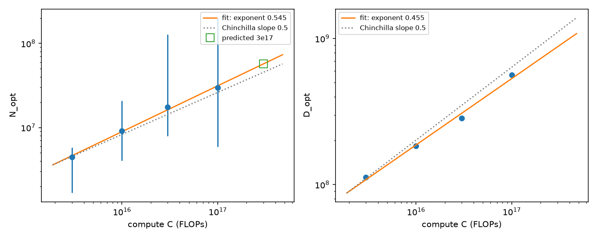
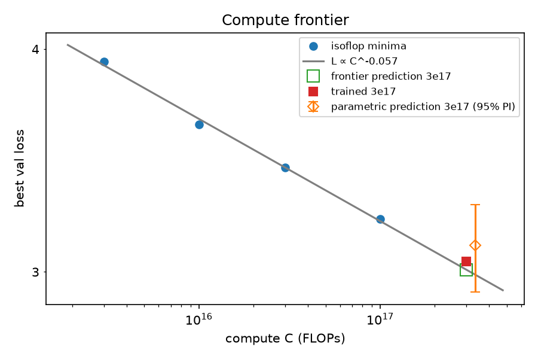
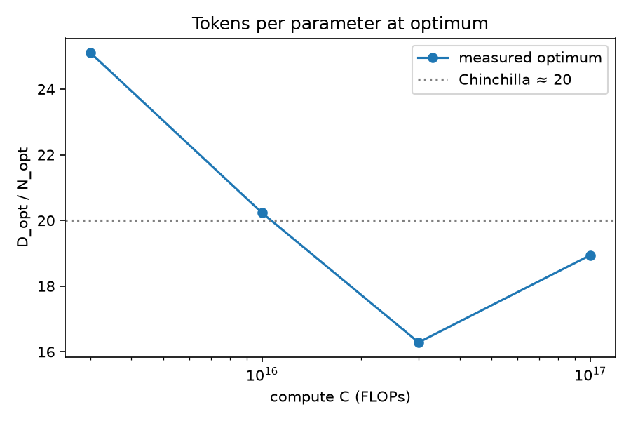
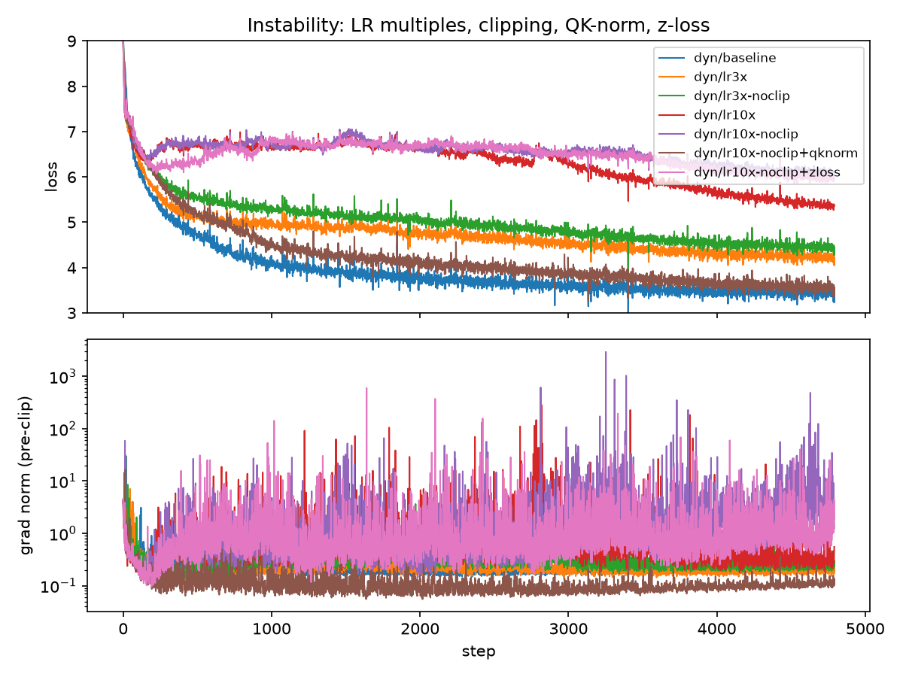
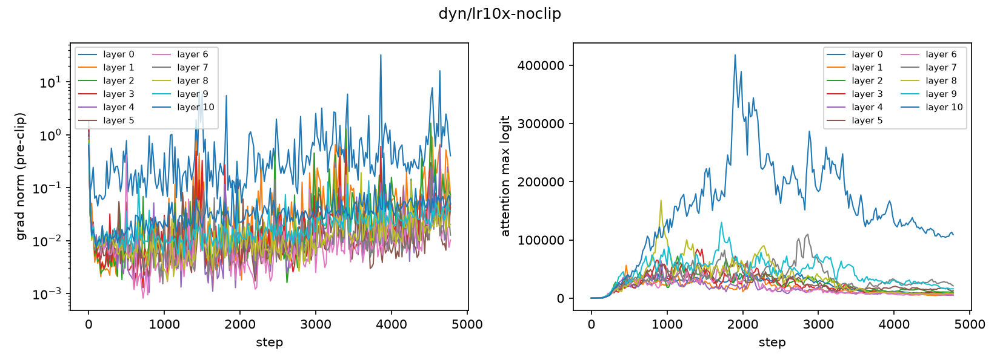
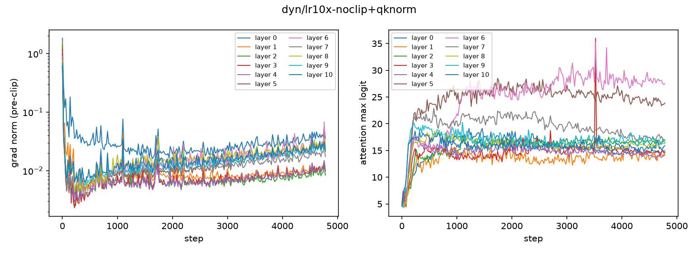
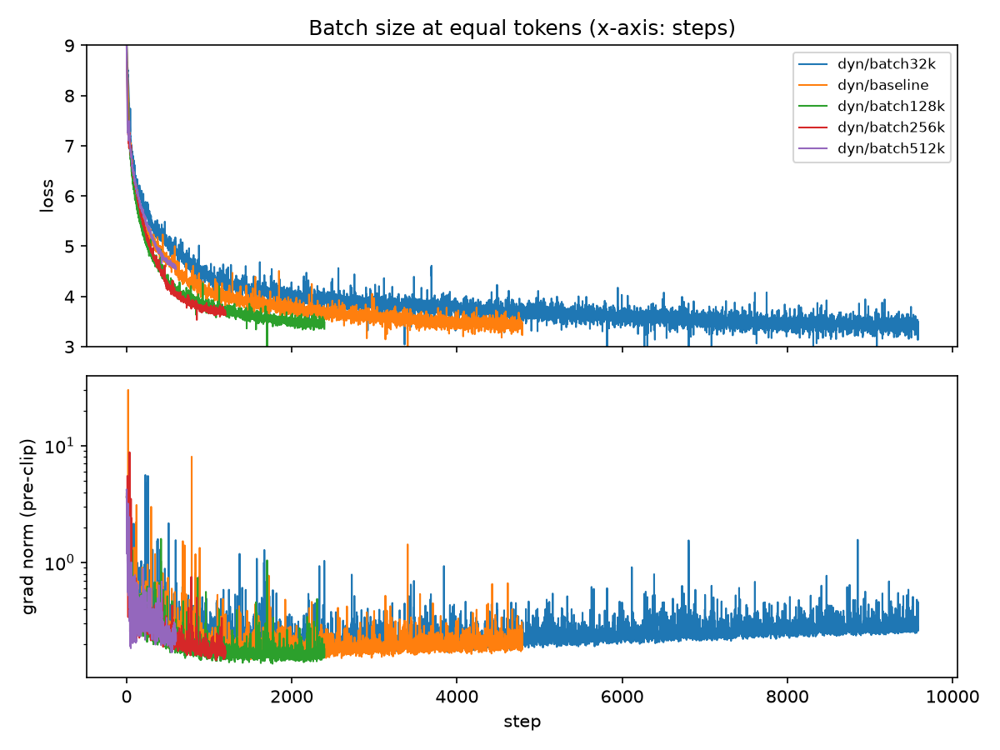

# Small GPT scaling laws, from scratch

I trained 79 Llama-style GPT runs (2.6M to 57M parameters) on FineWeb-Edu. From them I fitted compute-optimal scaling laws with two methods, then pre-registered and tested a prediction at 3x the largest training budget. Everything ran on rented H100s through Modal.

**TL;DR**

- **Exponent a in N_opt ∝ C^a:** isoflop fit **0.545** [0.120, 1.665]; parametric fit **0.565** [0.144, 0.881]. The two methods agree, and both are close to Chinchilla's ~0.5.
- **Tokens per parameter at the optimum:** 25, 20, 16 and 19 at budgets 3e15, 1e16, 3e16 and 1e17 FLOPs.
- **Pre-registered prediction at C = 3e17** (57.1M params, 875M tokens): parametric 3.106, isoflop frontier 3.008. **Actual: 3.0407.** The parametric prediction landed inside both of its intervals, at -0.76σ of seed noise.
- **Total cost:** 79 runs, 4.56 GPU-hours, **$18.00**.

Links: [W&B report](https://forge.coreweave.com/wandb/jfdasher-thermopylae-systems/gptlab-scaling/reports/Small-GPT-scaling-laws,-from-scratch--VmlldzoxODE1NDAzMg==) · [HF model (the 3e17 test run)](https://huggingface.co/jfdasher/gptlab-57m-3e17) · [Repo](https://github.com/jfdasher/gpt-scaling-laws-from-scratch)

Only the 57M test-run model is published on Hugging Face. The grid models are described here but not uploaded.

## What happens in a training step

The model ([gptlab/model.py](gptlab/model.py)) is a Llama-style decoder: RoPE, RMSNorm, SwiGLU, tied embeddings, head dim 64 and context 512. Module names mirror HF `LlamaForCausalLM`, so export is a key rename. One optimizer step in [gptlab/train.py](gptlab/train.py) goes like this:

1. **LR from the schedule** ([L340-L342](gptlab/train.py#L340-L342)). `lr_at` in [gptlab/schedule.py](gptlab/schedule.py) gives linear warmup over 5% of steps, then cosine decay to 10% of peak. The schedule is sized to each run's own length.
2. **Forward and backward over micro-batches** ([`forward_backward`, L160-L171](gptlab/train.py#L160-L171)). One step is `batch_tokens / (micro_batch * 512)` micro-batches. Each one reads a deterministic slice of the token stream (`step * accum + micro`, which makes resume exact). The forward pass runs under bf16 autocast ([L125-L127](gptlab/train.py#L125-L127)), and the loss is computed in fp32 ([`loss_fn`](gptlab/model.py#L157-L164), with optional z-loss). Each micro-batch backpropagates `total / accum`, so gradients accumulate to the mean over the step. The returned value is the mean plain cross-entropy.
3. **Non-finite loss guard** ([L344-L350](gptlab/train.py#L344-L350)). A NaN or inf loss writes forensics: the model and optimizer state, the token span and a `FAILED` marker. The run then fails loudly, and Modal does not retry it.
4. **Clipping** ([L356-L364](gptlab/train.py#L356-L364)). `clip_grad_norm_(..., 1.0)` returns the *pre-clip* norm, which is what gets logged. A non-finite norm is caught *before* `optimizer.step()`, because a NaN clip coefficient would poison every weight. Per-layer gradient norms are also taken pre-clip ([L353](gptlab/train.py#L353)).
5. **Fused AdamW, then zero_grad** ([L365-L366](gptlab/train.py#L365-L366)). The optimizer ([L130-L134](gptlab/train.py#L130-L134)) is `torch.optim.AdamW(fused=True)`: β = (0.9, 0.95) and weight decay 0.1 on matrices only. Gradients are then zeroed with `set_to_none=True`.
6. **Checkpoint on a timer** ([L388-L390](gptlab/train.py#L388-L390)). Every 600 s the model, optimizer, step, accumulated GPU seconds and RNG state are written atomically ([L137-L149](gptlab/train.py#L137-L149)) and committed to a Modal volume.

[gptlab/reference.py](gptlab/reference.py) holds a hand-written AdamW (bias-corrected moments, decoupled weight decay) and a hand-written causal attention. They exist to make the mechanics explicit. [tests/test_reference.py](tests/test_reference.py) checks them for parity against `torch.optim.AdamW` and `F.scaled_dot_product_attention`.

## Data and evaluation protocol

- **Data:** [FineWeb-Edu](https://huggingface.co/datasets/HuggingFaceFW/fineweb-edu) `sample/10BT`, 4 parquet files, giving 2,655,647,914 train tokens.
- **Split:** by document hash. A document goes to validation if `sha256(id) mod 1000 < 5` (0.5%), so no document is ever split across train and val. The val set is 8,116 docs and 10,000,376 tokens.
- **Frozen val set:** [data/val_manifest.json](data/val_manifest.json) records the source files, the token and byte counts and the SHA-256 of `val.bin` and of the tokenizer. It was committed (`8d08875`) before any training run. Every run verifies it at startup.
- **Tokenizer:** an 8,192-token byte-level BPE trained on the data. It gives 3.87 bytes/token on val (38,714,193 bytes / 10,000,376 tokens). Each final val loss is over the full 10M-token val set. Bits per byte are also reported, so the numbers can be compared across tokenizers.
- **Baselines** ([baselines.json](baselines.json)), measured on the frozen val set before training (commit `6d67df5`):

| Baseline | Loss (nats/token) | Bits per byte |
|---|---|---|
| Uniform over 8,192 tokens | 9.011 | 3.358 |
| Unigram | 7.297 | 2.719 |
| Interpolated bigram (λ = 0.95) | 5.190 | 1.934 |
| GPT-2 small (its own tokenizer; reference only) | n/a | 1.036 |
| This project's 57M test run | 3.041 | 1.133 |

## Method

**Grid.** 4 compute budgets (3e15, 1e16, 3e16 and 1e17 FLOPs) × 5 tokens-per-parameter ratios (5, 10, 20, 40 and 80). For each cell, N ≈ √(C / 6r) is snapped to a shape with d_model/n_layer near 32, and then D = C / 6N is rounded to whole batches. The 3e15 budget also has a second seed with a disjoint data offset, which gives a seed-noise estimate. The batch size is set per budget: 16k tokens at 3e15, 32k at 1e16 and 3e16, and 64k at 1e17. That choice came out of a failure, described under [What didn't work](#what-didnt-work).

**LR rule.** An LR sweep at three (budget, ratio) points ([lr_rule.json](lr_rule.json)) fitted `ln lr = 8.090 - 0.8285 ln N`, that is, lr ∝ N^-0.83. The third point is held out as a check: the rule's LR is 0.91× the sweep's best. Every grid and test run takes its LR from this rule.



**Schedule.** Warmup is 5% of each run's steps, followed by a cosine decay to 0.1 × peak at that run's last step. Each run gets its own full schedule, so no run is a truncated version of a longer one.

**Compute accounting.** C = 6ND, where N is the *total* parameter count, embeddings included (tied, so counted once) ([gptlab/flops.py](gptlab/flops.py)). Attention FLOPs (the QKᵀ and AV terms) are omitted. At seq_len 512 they are a small but nonzero share of compute, larger for the smallest models.

**Run identity and resume.** A run's ID is a SHA-256 of its behaviour-relevant config ([L63-L65](gptlab/train.py#L63-L65)). A run whose `result.json` exists is never retrained, and runs shared between phases (for example the 3e16/r20 baseline) are reused rather than repeated. Modal containers can be preempted. On restart, a run resumes from its last atomic checkpoint, including the RNG state and data position. [tests/test_train.py](tests/test_train.py) checks that resume is exact on CPU in fp32. On Modal, a smoke run was preempted at step 100 of 200, resumed through a Modal retry, and logged every step exactly once. Each result's `git_commit` ends in `-dirty` when untracked or uncommitted local files existed at launch time; runs remain traceable by config and run_id.

## Scaling results

**Method 1: IsoFLOP parabolas.** At each budget I fit a parabola of loss against ln N and take its vertex. I then fit ln N_opt = a ln C + k ([results/fits/isoflop.json](results/fits/isoflop.json)). The 95% intervals come from a bootstrap that perturbs each loss with seed noise σ = 0.085 nats.

| Budget (FLOPs) | N_opt [95% CI] | D_opt | Tokens/param | Min loss |
|---|---|---|---|---|
| 3e15 | 4.46M [1.67M, 5.78M] | 112M | 25.1 | 3.936 |
| 1e16 | 9.08M [4.04M, 20.9M] | 184M | 20.2 | 3.629 |
| 3e16 | 17.5M [7.96M, 128M] | 285M | 16.3 | 3.432 |
| 1e17 | 29.7M [5.90M, 202M] | 562M | 18.9 | 3.212 |

All four optima are interior. The fit gives **a = 0.545 [0.120, 1.665]** and b = 1 - a = 0.455.

**Method 2: Parametric fit.** I fit L(N, D) = E + A/N^α + B/D^β with Huber loss on log-loss and a bootstrap ([results/fits/parametric.json](results/fits/parametric.json)):

| Parameter | Estimate | 95% CI |
|---|---|---|
| E | 2.716 | [~0, 3.004] |
| A | 773 | [9.6, 16,464] |
| B | 35,348 | [9.8, 3.16e7] |
| α | 0.457 | [0.073, 0.667] |
| β | 0.594 | [0.064, 0.991] |
| implied a = β/(α+β) | **0.565** | [0.144, 0.881] |

**The two estimates of a agree** (0.545 and 0.565). The parametric intervals on individual parameters are very wide: with 20 seed-averaged grid points over a 33x compute range, E, A and B trade off against one another. Besiroglu et al. (2024) report the same thing in their Chinchilla replication. The implied a is much better constrained than any single parameter.






**Prediction test at C = 3e17.** [predictions/3e17.json](predictions/3e17.json) was committed and tagged `prediction-3e17` before the test run started. The isoflop fit put N_opt at 57.1M [10.5M, 1.21B], and the parametric fit at 56.3M [31.4M, 140M]. I declared a run of 17 layers × 512 (57,132,544 params) on 875,167,744 tokens (15.3 tokens/param) at LR 1.22e-3 from the rule. Outcome ([predictions/3e17_outcome.json](predictions/3e17_outcome.json)):

| Method | Predicted | Interval | Actual | Error | Error / σ_seed |
|---|---|---|---|---|---|
| Parametric | 3.106 | param 3.032-3.193; prediction 2.923-3.271 | 3.0407 | -0.065 (-2.1%) | -0.76 |
| IsoFLOP frontier | 3.008 | point estimate | 3.0407 | +0.033 (+1.1%) | +0.38 |

The two methods bracket the result. The parametric fit's floor (E ≈ 2.7) makes it slightly pessimistic, and the floor-free log-log frontier is slightly optimistic. At 3x extrapolation in compute, both are within 1σ of seed noise.

## Training dynamics

These runs all use a 16M-parameter model at 3e16 FLOPs with the rule LR of 3.52e-3. The baseline (64k batch, 5% warmup, β₂ = 0.95) ends at 3.445.

**Instability is attention-logit growth, and it never shows up as NaN.** At 3x the LR, the run ends at 4.24 with clipping and 4.46 without. At 10x, it ends at 5.38 with clipping and 6.10 without. None of these runs went NaN. Per-layer diagnostics, logged every 20 steps, show the mechanism. The attention max-logit grows from ~0.7 at init, peaking at up to ~2e4 (3x) and ~4e5 (10x), and it is worst in the last layers. With QK-norm it stays bounded (final 14-28, peak 36). The softmax saturates and attention becomes one-hot. Middle-layer gradient norms collapse to ~0.01 while layer 0 spikes, and the loss stalls near 6.6 until the LR decays. This is the failure mode described by Dehghani et al. (2023) and Wortsman et al. (2023). A NaN guard alone would never have caught it. Clipping narrows the gap but does not stop the logit growth.

**QK-norm fixes it, z-loss does not.** At 10x LR without clipping:

| Variant | Final val loss |
|---|---|
| Unmodified | 6.105 |
| + z-loss (1e-4) | 5.974 |
| + QK-norm | 3.574 |
| Tuned baseline (1x LR) | 3.445 |

With QK-norm, the max attention logits stay bounded at ~14-30. z-loss penalises the output softmax normaliser (log Z of the vocabulary logits), not the attention logits, so it cannot reach this failure mode.





**Warmup.** 5% warmup gives 3.445, 1% gives 3.520 and 0% gives 3.680. At this LR, even 1% warmup costs 0.075 nats.

**β₂.** 0.999 gives 3.477, against 3.445 at 0.95. The slower second-moment estimate lags the fast-changing early gradients.

**Batch size** (equal tokens, same LR):

| Batch | 32k | 64k | 128k | 256k | 512k |
|---|---|---|---|---|---|
| Val loss | 3.433 | 3.445 | 3.472 | 3.687 | 4.591 |

At this scale, 64k sits near the critical batch size. Halving it gains ~0.01; doubling it costs 0.03, then 0.24, then 1.15. Every batch size here used the same LR, which is a caveat on these numbers.



## What didn't work

**Grid v1 was step-starved at small budgets.** The first grid used a 64k-token batch everywhere. At 3e15, the large-N cells got only 753-1,492 optimizer steps, and the budget looked broken. Seed pairs differed by up to 0.26 nats. The losses did not form a parabola. The 10M-param r5 cell ended at 5.08, barely under the bigram baseline. None of the runs had spikes, and the seed curves separated early and then ran parallel. The final-30% slope dL/d ln(step) was -0.66 to -0.77, against -0.27 to -0.42 elsewhere: these runs were still falling steeply when they ended. My hypothesis was step starvation. I tested it with a **$0.24 probe**: 3e15/r20 rerun at a 16k batch (4x the steps, with the same tokens, LR and FLOPs). With both seeds, it went from 4.531 / 4.275 to 3.897 / 3.898. The bias is systematic: the large-N cells get the fewest steps, which pushes N_opt down at small C and steepens a. The probe's two runs are the same configs as the grid v2 3e15/r20 pair, re-run: they differ only in `tag`, which is hashed into the run_id. Val loss differs by 0.0043 (seed 0) and 0.0034 (seed 1), which is a GPU-nondeterminism floor of about 0.003-0.004, well below the seed noise σ. Grid v2 uses a batch size per budget ([results/fits/isoflop_v1.json](results/fits/isoflop_v1.json) vs [isoflop.json](results/fits/isoflop.json)):

| Budget | v1 N_opt (64k batch) | v2 N_opt (per-budget batch) |
|---|---|---|
| 3e15 | 2.01M (at grid edge, 124 tok/param) | 4.46M (25 tok/param) |
| 1e16 | 7.19M (32 tok/param) | 9.08M (20) |
| 3e16 | 12.9M (30 tok/param) | 17.5M (16) |
| 1e17 | 29.7M (19 tok/param) | 29.7M (19), the same runs |
| **Exponent a** | **0.747** [0.128, 3.120] | **0.545** [0.120, 1.665] |
| Seed σ | 0.106 | 0.085 |

**LR sweeps hit the edge of the grid, and the gate refused.** In the first LR pass, the 2.6M and 9.3M optima sat on the *upper* edge of their LR grids. `sweep.py fit-lr-rule` refuses to write a rule when any group's optimum is on an edge, and it did. I moved the small-end centre up 4x, which made 1.6e-2 interior (3.2e-2 and 6.4e-2 gave 4.57 and 5.22, against 3.95). For the check point, I first shifted the centre 4x to 1.2e-2 (two new runs, at 1.2e-2 and 2.4e-2), which left the optimum at 6e-3 on the *lower* edge of the new grid. The earlier 3e-3 run already bracketed it, so I recentred on 6e-3 (3e-3, 6e-3 and 1.2e-2, all already run). Only that final recentre was free. The sweep also showed how close the cliff is: 9.3M goes from 3.656 at 6e-3 to 4.391 at 1.2e-2.

**The seed-noise estimator is dominated by one pair.** In grid v2, σ = 0.085 nats is mostly the 3e15/r5 pair (4.270 vs 4.019). The other pairs differ by 0.098, 0.0005, 0.016 and 0.004. The r5 gap is not instability (max grad norm 5.8, no attention blow-up). Train-loss bumps of ~0.2 appear at identical steps in runs that read the same data region, so they look data-driven. I kept the pre-registered estimator (RMS over all pairs) rather than switching to a robust one after seeing the data. The isoflop intervals on a are therefore wide, and probably pessimistic at the larger budgets.

**Small operational mistakes:**
- The first `prep_data` failed before doing anything. Modal validates every secret an app references at startup, even for functions that don't use it, and the `wandb` secret didn't exist yet.
- I re-ran `baselines` after `baselines.json` had already been written, wasting ~$0.30.
- W&B media panels show an image at one logged step, so the report figures had to be logged at step 0 (the `report/figures-step0` run) before they appeared.

**Pre-spend reviews caught real bugs.** Before any GPU spend, each task and then the whole branch was reviewed. Three of the bugs those reviews found would have cost money or corrupted results:
- `starmap` input retries are client-side. A launcher that called `starmap` from the local entrypoint under `--detach` would have lost its retries when the client disconnected. Orchestration now runs server-side, in a `run_phase` Modal function.
- Modal reuses warm containers. With wandb 0.31, `wandb.init` while a run is still active returns that run, so the next config would have logged into the previous run. The fixes were single-use containers, a `finish()` on every exit path and `reinit="finish_previous"`.
- A literal `<|endoftext|>` in document text was encoded as the special EOT token. That split documents mid-text and broke the EOT-count invariant. Now only the appended EOT is special.

## Cost

H100 time is billed at $3.95/hour. The figures come from [results/costs.csv](results/costs.csv) (`uv run python -m analysis.costs results`). No runs failed.

| Phase | Runs | GPU-hours | Cost |
|---|---|---|---|
| smoke | 2 | 0.03 | $0.11 |
| lr | 17 | 0.72 | $2.84 |
| grid (v1: 25 runs at 64k, $6.67; v2: 19 reruns, $3.00) | 44 | 2.45 | $9.68 |
| probe | 2 | 0.06 | $0.24 |
| dynamics (incl. QK-norm / z-loss fixes) | 13 | 0.93 | $3.67 |
| test (3e17) | 1 | 0.37 | $1.47 |
| **Total** | **79** | **4.56** | **$18.00** |

Data prep (CPU), the baselines and the bench are not in the ledger.

Per-run costs for the runs named above:
- 3e17 test run, `test/3e+17` (57.1M params, val 3.0407): this run: 0.37 GPU-hours, $1.47
- Best at 3e15, `grid/3e+15/r20` (5.1M, 16k batch, val 3.9012): this run: 0.03 GPU-hours, $0.11
- Best at 1e16, `grid/1e+16/r20` (9.3M, 32k batch, val 3.6434): this run: 0.04 GPU-hours, $0.14
- Best at 3e16, 3e16/r20 at 32k (the identical run `dyn/batch32k`, 15.9M, val 3.4328): this run: 0.07 GPU-hours, $0.28
- Best at 1e17, `grid/1e+17/r20` (27.9M, 64k batch, val 3.2101): this run: 0.18 GPU-hours, $0.71
- 10x LR, no clip, `dyn/lr10x-noclip` (val 6.1047): this run: 0.07 GPU-hours, $0.27
- Its QK-norm fix, `dyn/lr10x-noclip+qknorm` (val 3.5741): this run: 0.08 GPU-hours, $0.33

## Reproduce

**Prerequisites:**
- [uv](https://docs.astral.sh/uv/)
- A Modal account, authenticated (`uv run modal setup`)
- Two Modal secrets:
  - `uv run modal secret create wandb WANDB_API_KEY=<key>`
  - `uv run modal secret create huggingface HF_TOKEN=<token with write scope>`

Modal checks all secrets at startup, so create both before running anything. Tests run on CPU: `uv sync && uv run pytest -q`.

Before each GPU phase, `uv run python sweep.py plan <phase>` prints the configs, the runs it will skip and the cost estimate.

```bash
# Phase 0-1: data, baselines, smoke test (preemption-resume), throughput bench
uv run modal run modal_app.py::prep_data
uv run modal run modal_app.py::baselines
uv run modal run --detach modal_app.py::launch --phase smoke --yes
uv run modal run modal_app.py::pull_results
uv run modal run modal_app.py::bench

# Phase 2: LR sweep and LR rule
uv run modal run --detach modal_app.py::launch --phase lr --yes
uv run modal run modal_app.py::pull_results && uv run python sweep.py fit-lr-rule --results results

# Phase 3-4: isoflop grid (v2), step-starvation probe, training dynamics and fixes
uv run modal run --detach modal_app.py::launch --phase grid --yes
uv run modal run --detach modal_app.py::launch --phase probe --yes
uv run modal run modal_app.py::pull_results
uv run modal run --detach modal_app.py::launch --phase dynamics --yes
uv run modal run --detach modal_app.py::launch --phase dynamics-fix --from-run dyn/lr10x-noclip --yes
uv run modal run modal_app.py::pull_results
uv run python -m analysis.isoflop results            # add --grid v1 for the failed 64k grid

# Phase 5: fit, predict, commit and tag before the test run
uv run python -m analysis.isoflop results && uv run python -m analysis.parametric results
uv run python -m analysis.predict make --results results --lr-rule lr_rule.json --out predictions/3e17_repro.json
git add predictions/3e17_repro.json && git commit -m "prediction" && git tag -a prediction-3e17-repro -m "Prediction committed before the 3e17 run"
# (the original predictions/3e17.json and tag prediction-3e17 already exist in the repo, hence the _repro names)

# Phase 6: test run and comparison
uv run modal run --detach modal_app.py::launch --phase test --yes
uv run modal run modal_app.py::pull_results
uv run python -m analysis.predict compare --prediction predictions/3e17_repro.json --results results
uv run python -m analysis.plots results figures
uv run python -m analysis.costs results

# Phase 7: publish the test-run model
uv run modal run modal_app.py::publish --run-id <id> --repo-id <user/name> [--public]
```

The step-starvation probe was a diagnostic added mid-project. To reproduce grid v1 itself, you need the 64k grid configs (`sweep.grid_v1_configs`).

## Limitations and next steps

- **Scale.** The largest model is 57M parameters, and the fits cover 3e15 to 1e17 FLOPs. That is four budgets over a 33x range. Small models are also launch-bound on an H100 (MFU 4.7% at 2.6M, 24% at 57M, from [bench.json](bench.json)).
- **Few seeds.** Only the 3e15 budget has a second seed, and the noise estimate is dominated by one pair. The intervals on a are wide.
- **8k vocabulary.** Embeddings are a large share of N for the small models, and I counted them in N. A different vocabulary or N convention would shift the optima.
- **The batch sweep used the same LR at every batch size.** The penalty for large batches is partly an LR mismatch.
- **6ND ignores attention FLOPs.** This slightly understates compute, and it does so unevenly across shapes.
- **Next steps:**
  - A WSD (warmup-stable-decay) schedule, so that one run yields many budgets.
  - μP, so the LR transfers across width without a fitted rule.
  - More budgets above 1e17 and more seeds per cell, to tighten a.

## License

The code is under Apache-2.0 ([LICENSE](LICENSE)). The model on the Hugging Face Hub is also under Apache-2.0. The training data is [FineWeb-Edu](https://huggingface.co/datasets/HuggingFaceFW/fineweb-edu) from HuggingFaceFW, released under ODC-By.
